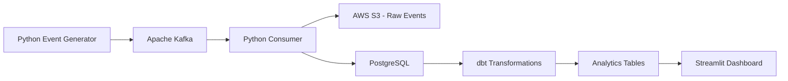

# Real-Time E-Commerce Event Processing Platform

An end-to-end Data Engineering project that simulates e-commerce customer activity, streams events through Apache Kafka, stores raw data in AWS S3, processes structured data in PostgreSQL, and transforms it using dbt.

## Project Overview

This project demonstrates a real-time event-driven data pipeline using synthetic e-commerce events.

It simulates customer activities such as:
- Product views
- Add to cart
- Order placement
- Payment success
- Payment failure

Events are continuously generated and streamed through Kafka, then consumed and stored for analytics.

## Architecture



## Technology Stack

| Technology | Purpose |
|---|---|
| Python | Event generation and consumption |
| Apache Kafka | Real-time event streaming |
| AWS S3 | Raw event storage |
| PostgreSQL | Structured event storage |
| dbt | Data transformation and testing |
| Streamlit | Interactive dashboard |
| Plotly | Data visualization |
| Docker | Kafka containerization |
| Git & GitHub | Version control |

## Project Structure

```text
realtime-ecommerce-platform/
├── src/
│   ├── event_generator.py
│   ├── producer.py
│   ├── consumer.py
│   ├── db_test.py
│   └── dashboard.py
├── data/
│   └── raw/
├── config/
├── tests/
├── ecommerce_dbt/
│   └── models/
│       ├── staging/
│       │   ├── sources.yml
│       │   └── stg_events.sql
│       └── marts/
│           └── fct_product_events.sql
├── requirements.txt
└── README.md
```

## Data Pipeline

1. **Event Generation:** Python generates synthetic e-commerce events with unique event IDs, customer IDs, product details and timestamps.
2. **Streaming:** Kafka receives events in the `ecommerce_events` topic.
3. **Consumption:** A Python consumer reads Kafka messages in batches.
4. **Data Storage:** Events are archived in AWS S3 and inserted into PostgreSQL.
5. **Transformation:** dbt creates staging views and analytical fact tables.
6. **Visualization:** Streamlit displays event activity, product performance and payment metrics.

## Analytics

The dashboard provides insights into:
- Total events and unique customers
- Product views and add-to-cart activity
- Order counts
- Successful and failed payments
- Product-level event performance
- Event activity over time

## Running the Project

### 1. Clone the repository

```bash
git clone <YOUR_GITHUB_REPOSITORY_URL>
cd realtime-ecommerce-platform
```

### 2. Create a virtual environment

```powershell
python -m venv .venv
.\.venv\Scripts\Activate.ps1
```

### 3. Install dependencies

```powershell
pip install -r requirements.txt
```

### 4. Start Kafka

Start Docker Desktop, then:

```powershell
docker start kafka
```

### 5. Start the event generator and producer

In separate terminals:

```powershell
python src/event_generator.py
```

```powershell
python src/producer.py
```

### 6. Start the consumer

```powershell
python src/consumer.py
```

Configure your PostgreSQL and AWS credentials securely before running the consumer. Never commit passwords, access keys or `.env` files.

### 7. Run dbt

```powershell
.\.venv\Scripts\dbt.exe run --project-dir .\ecommerce_dbt
```

```powershell
.\.venv\Scripts\dbt.exe test --project-dir .\ecommerce_dbt
```

### 8. Launch the dashboard

Set your PostgreSQL password in the terminal:

```powershell
$env:POSTGRES_PASSWORD = Read-Host "Enter PostgreSQL password"
```

Then:

```powershell
streamlit run src/dashboard.py
```

Open `http://localhost:8501`.

## Important Notes

- This project uses synthetic e-commerce data for demonstration.
- AWS S3 storage may incur charges depending on usage and account configuration.
- The current event generator maintains pending orders in memory.
- The pipeline uses batch-based consumer writes and does not guarantee exactly-once delivery across PostgreSQL, S3 and Kafka.

## Future Improvements

- Add automated pipeline monitoring.
- Implement stronger failure recovery and idempotency.
- Add data quality monitoring.
- Deploy the pipeline to cloud infrastructure.
- Add CI/CD using GitHub Actions.

## Author

**Kunal Muneshwar**

Data Engineering | Python | SQL | Kafka | AWS | PostgreSQL | dbt
